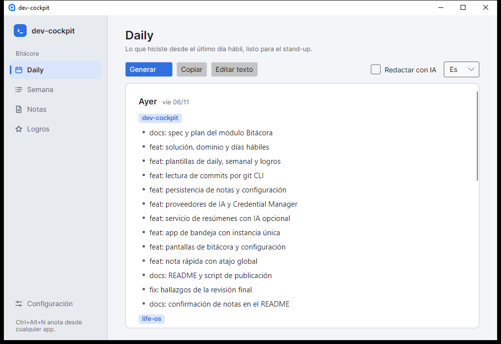

# dev-cockpit

[Read in English](README.md)



App de escritorio para el día a día de un dev. Vive en la bandeja del sistema y, por ahora, trae el
módulo **Bitácora**:

- **Nota rápida** con `Ctrl+Alt+N` desde cualquier app: escribís, Enter, listo. Se puede marcar
  como **logro** y agregarle un número ("de 4 s a 300 ms").
- **Daily** (Ayer / Hoy / Bloqueos) armada con tus commits y notas del último día hábil
  (el lunes mira el viernes).
- **Semanal** agrupado por repo.
- **Logros** exportables a Markdown, para el CV y las evaluaciones de desempeño.
- Resúmenes en **español o inglés**, redactados por IA **opcional**: Ollama (local, por defecto),
  Claude o ChatGPT. Sin IA, salen igual con una plantilla. Con Ollama el texto **aparece en vivo**
  mientras se genera, con un contador y botón Cancelar.
- Tema **claro, oscuro o el de Windows**, y opción para **no precargar la IA** al abrir (Ollama
  ocupa ~5 GB de RAM: útil si usás la misma PC para jugar).

Próximos módulos (ver `docs/superpowers/specs/`): Entornos (Docker y puertos) y Queries
(`EXPLAIN ANALYZE` de PostgreSQL).

## Instalación

1. Generar el ejecutable (necesita el SDK de .NET 10):

   ```powershell
   .\scripts\publish.ps1
   ```

   Queda en `dist\DevCockpit.App.exe` (~114 MB: trae .NET adentro, no hace falta instalarlo).

2. IA local (opcional, recomendado): instalar [Ollama](https://ollama.com) y bajar el modelo:

   ```powershell
   ollama pull qwen2.5:7b-instruct
   ```

   En una PC con disco HDD y sin GPU compatible, la **primera** carga del modelo tarda ~3 minutos.
   La app lo precarga al abrirse y lo mantiene en memoria 1 hora (~5 GB de RAM), así que en el uso
   normal una daily tarda ~45 s. Si la PC tiene poca RAM libre o la usás para otras cosas pesadas,
   desmarcá **Precargar la IA al abrir** en Configuración.

3. Arrancar con Windows: `Win+R` → `shell:startup` → crear un acceso directo a
   `DevCockpit.App.exe` y agregarle `--minimized` al final del destino (arranca solo en la bandeja).

## Primer uso

En **Configuración**:

1. **Agregar carpeta…** por cada repo que quieras seguir.
2. Revisar **tus emails de git** (se precarga `git config --global user.email`). Si en el trabajo
   commiteás con otro email, agregalo en otra línea.
3. Elegir la IA y **Guardar**. **Probar IA** confirma que responde.

## Privacidad

- Todo se guarda en tu PC: `%APPDATA%\DevCockpit\` (`settings.json` y `devcockpit.db`).
- Las API keys de Claude y ChatGPT van al **Administrador de credenciales de Windows**
  (`DevCockpit:anthropic`, `DevCockpit:openai`), nunca al JSON.
- Con **Ollama** nada sale de la PC.
- Con **Claude o ChatGPT**, antes de cada envío la app muestra **el texto exacto** que se va a
  mandar y pide confirmación. "No volver a preguntar" se guarda por repo; si el resumen incluye
  notas, pregunta siempre (las notas no pertenecen a ningún repo).
- La IA recibe el borrador ya armado (commits y notas), no el código ni los diffs.

## Desarrollo

```powershell
dotnet test                                   # 162 tests
dotnet run --project src/DevCockpit.App       # correr en modo debug
```

| Proyecto | Qué tiene |
|---|---|
| `src/DevCockpit.Core` | Dominio, puertos y lógica pura (días hábiles, plantillas, servicio de resúmenes, atajos). Sin IO. |
| `src/DevCockpit.Infrastructure` | Adaptadores: git por CLI, SQLite, JSON, Ollama / Claude (SDK oficial) / ChatGPT, Credential Manager. |
| `src/DevCockpit.App` | Avalonia + CommunityToolkit.Mvvm: bandeja, ventanas, atajo global (SharpHook). |
| `tests/*` | xUnit. Los de git crean repos temporales reales. |

Diseño y plan: `docs/superpowers/specs/2026-11-07-dev-cockpit-design.md` y
`docs/superpowers/plans/2026-11-07-bitacora.md`.

## Licencia

[MIT](LICENSE)

## Limitaciones conocidas

- Solo probado en Windows 10. Avalonia corre en Mac y Linux, pero las API keys hoy solo se guardan
  en Windows.
- Con un modelo local de 7B la redacción a veces se equivoca en matices (por ejemplo, traducir
  "días hábiles" como "holiday"). El borrador sin IA siempre está disponible desmarcando **Usar IA**.
